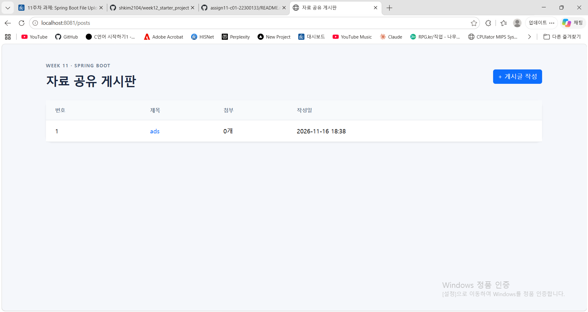
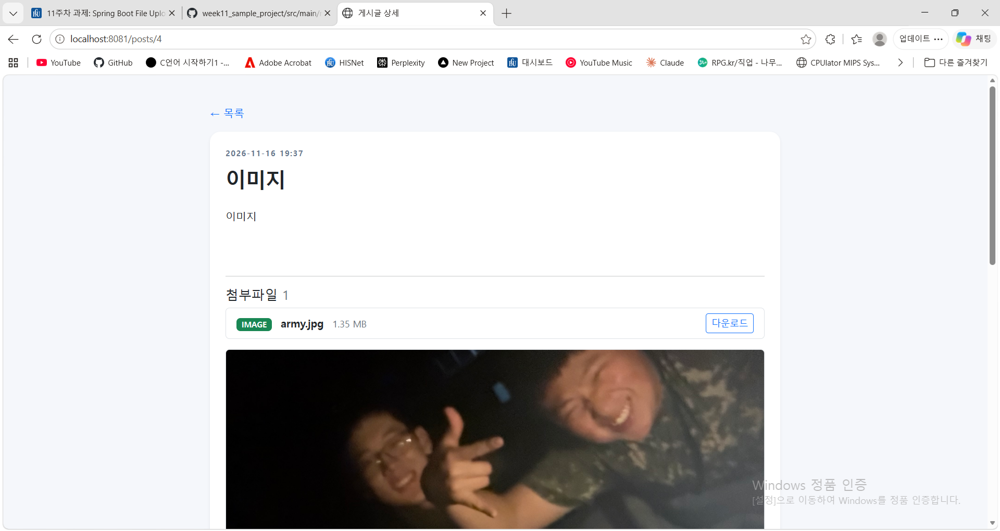
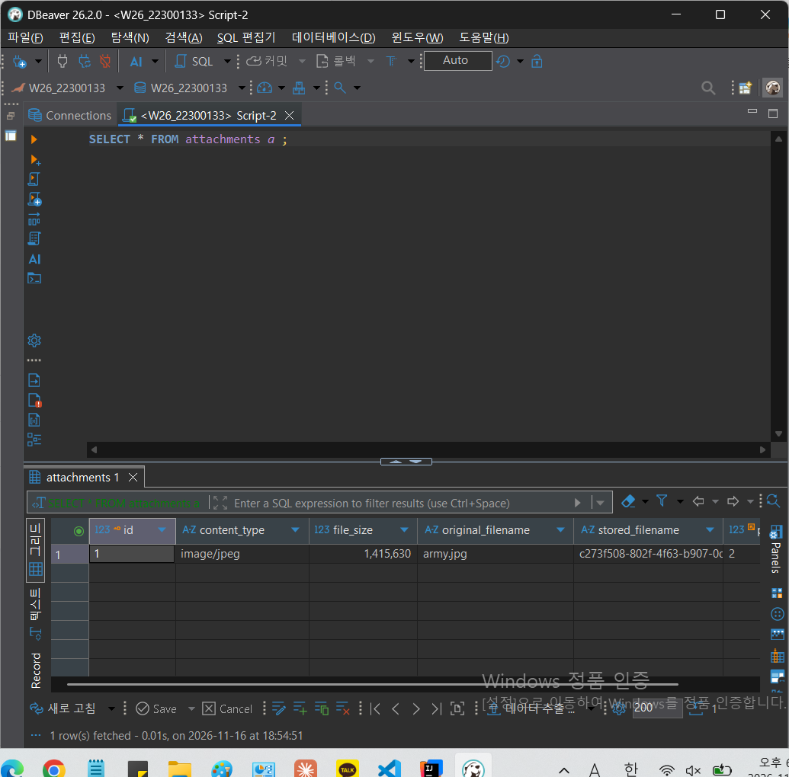

# Week 11 — Attachment Board (Student Sample)

render : https://webd-week11-sample-project.onrender.com

github : https://github.com/shkim2104/WebD_week11_sample_project

Spring Boot + Thymeleaf + JPA + MariaDB: 게시글 CRUD / 다중 첨부파일 업로드 / 다운로드

## 실행하기
1. Java 17+ 및 MariaDB 준비, `CREATE DATABASE web11 CHARACTER SET utf8mb4;`
2. 환경변수 `DB_URL`, `DB_USERNAME`, `DB_PASSWORD`를 자신의 MariaDB에 맞게 설정. 기본값은 `jdbc:mariadb://localhost:3306/web11`, `webuser`, `webpass`.
3. Gradle이 설치된 환경: `gradle bootRun` / IntelliJ: `AttachmentBoardApplication.main()` 실행.
4. 접속: http://localhost:8080/posts

> Gradle Wrapper는 이 ZIP에 포함되어 있지 않습니다. IntelliJ의 Gradle 지원 또는 설치된 Gradle을 사용하세요. `gradle wrapper` 실행 후 생성된 wrapper 파일은 Git에 포함하는 것을 권장합니다.

## 구현된 기능
- 게시글 목록 / 생성 / 상세 / 수정 / 삭제
- 게시글 생성 시 여러 파일 선택, UUID 이름으로 `uploads/`에 저장
- `attachments` 테이블에 메타데이터 저장
- 첨부파일 다운로드 (`GET /attachments/{id}/download`)

## 학생 과제 (TODO)
1. 코드를 분석하여 업로드/다운로드 요청 흐름 정리
2. 화면이나 정보 표시 3곳 이상 수정
3. **이미지 미리보기** 구현: `GET /attachments/{id}/view` + 상세 화면 `` 표시. 이미지(jpg/jpeg/png/gif)만 허용하고 `Content-Type` 정확히 설정
4. 정상/오류 테스트 후 README 및 Weekly Review 작성

## 코드 위치
- `PostController`: 게시글 화면 / Form
- `AttachmentController`: 다운로드 + 미리보기 TODO
- `PostService`: JPA CRUD와 파일 저장 연결
- `FileStorageService`: 파일 검증 / UUID 저장 / 로드
- `Post`, `Attachment`: 1:N 관계
- `templates/posts/detail.html`: 미리보기 TODO

## 주의사항
- 학습용 프로젝트입니다. 로그인/접근 권한, 업로드 파일의 실제 바이트 검증, 악성 파일 검사, CSRF 보호, 파일 저장과 DB 트랜잭션의 완전한 일관성 보장 등은 구현하지 않았습니다. 인터넷 공개 배포 전에 보강이 필요합니다.
- `spring.jpa.hibernate.ddl-auto=update`는 학습용 설정이며 운영 DB에는 그대로 사용하지 않습니다.
- Render 기본 파일 시스템에 저장된 업로드 파일은 재시작/재배포 시 유지되지 않을 수 있습니다. 이번 과제는 **로컬 파일 처리**를 평가합니다.

## Source Code Exploration & Analysis

- 1. PostRepository는 DB에 접근하여 연결하는 담당입니다. save(), findAll(), findById(), deleteById()이 자동으로 저장되어 있으며
     일반적으로 내장되어 있어서 사용 할 수 있고 sql에서 직접 볼 수 있습니다.
     PostController는  브라우저 요청을 받아서 URL을 메서드에 매핑(@GetMapping, @PostMapping)하고,
     입력값을 받아 Service를 호출한 뒤, 결과를 Model에 담아 뷰 이름을 반환하거나 redirect 합니다
     PostService는 비즈니스 로직 담당입니다.
     게시글 저장, 수정, 삭제 규칙과 파일 저장 처리, 트랜잭션(@Transactional)을 맡고 Repository를 호출합니다.
  2. 세 개 모두 스프링 빈으로 등록되고, 모두 di로 연결되어서 Controller가 Service를 필드로 갖고, Service가 Repository를 필드로 갖습니다.
  3. 게시글 하나에 첨부파일 여러 개가 달리므로 Post : Attachment = 1 : N (일대다) 관계입니다.
  4. cascade 는 "부모가 삭제될 때 같이 삭제"이고 orphanRemoval 은 부모의 클래서가 살아 있어도 관계가 샂게되면 끝이기 때문입니다. 그리고, 두 관계에서 디스크의 실제 파일은 
     영향을 받지 않아서 직접service에서 직접 삭제해야합니다.
  5. multipartfile은 업로드 파일을 하나로 표현하는 spring data의 인터페이스 입니다. 파일의 정보를 담고 있어서 , 업로드된 파일은 스프링에서 요청받은 
     데이터를 해석 -> 객체로 만들고 , 잠시 임시보관하는 메모리나 파일에 저장 -> service로 넘어가 uuid 기반 저장 파일을 만들어서 -> 실제 ㅍ파일로 저장합니다. -> db에도 메타정보만
     따로 저장받아서 db에 저장됩니다.
  6. uuid로 저장하는 이유는 만약 파일 이름이 동일하다면 나중 파일이 먼저 덮어 쓰기 때문에 충돌을 막는 것을 방지하고 호환성과 보안을 챙기고 싶기 때문입니다.
  7. 파일 다운로드 시 Resource, ResponseEntity, Content-Disposition은 각각 어떤 역할을 하는가?
        - 파일 다운로드시 resouce는 데이터를 반환하는 객체이고, enetity는 상태와 코드를 정하고 내용을 담아서 다음단계로 넘기고 enetity에서 받은 Content-Disposition이
          화면에 브라우저가 저장해서 화면에 띄워서 보여줍니다. 
        - 파일 저장 과정에서 normalize()와 startsWith()를 사용하는 이유는 무엇인가?
            uuid를 사용하기 때문에 보안을 유지하기 위해서 사용합니다.

## 바꾼 내용들 
 - Customizing
    -  
    -  
    - 
    - 